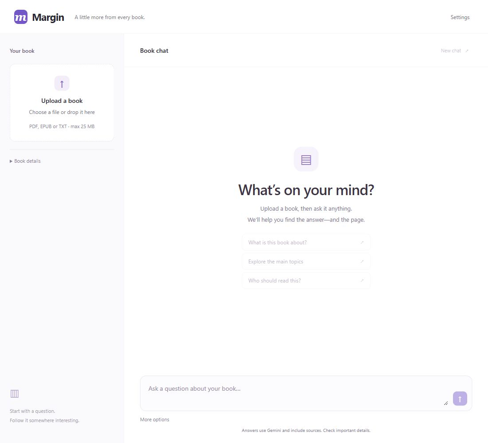
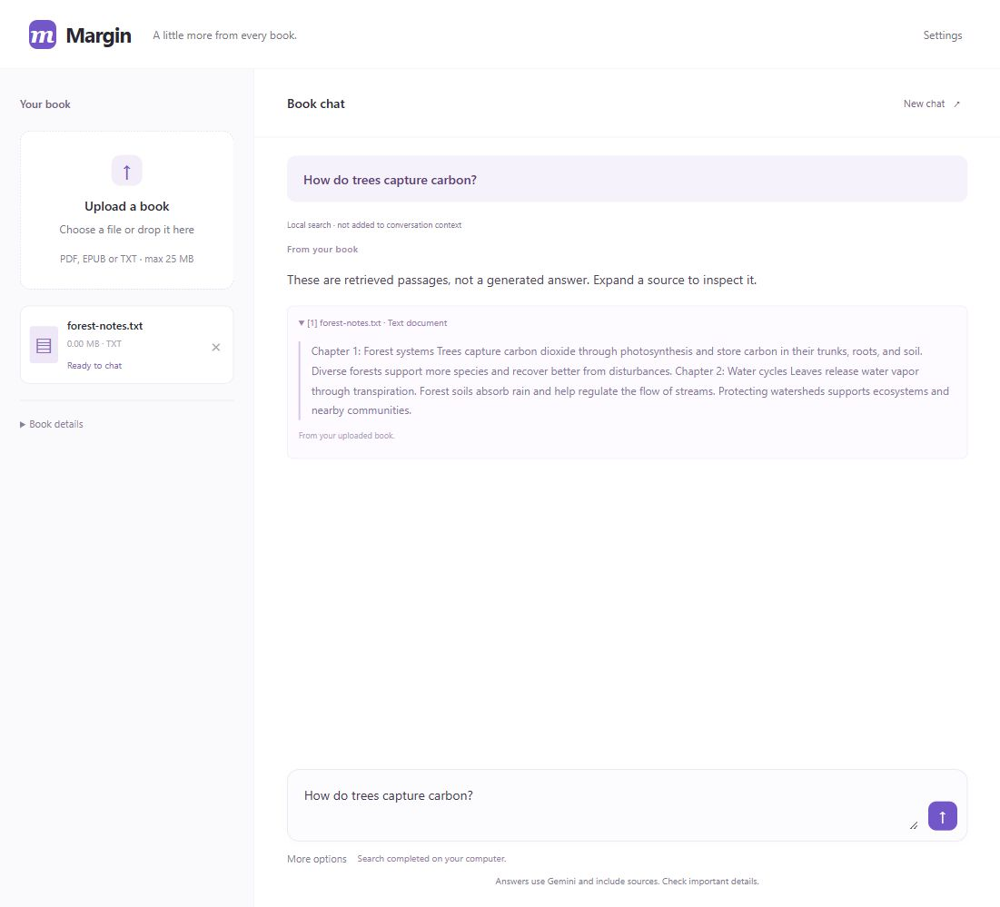

# Margin

### Chat with your book. Follow the sources.

Upload a PDF, EPUB, or text file and ask questions about it. Margin reads the book, builds a local semantic index, and uses Gemini to answer with page or section references. Scanned PDFs are supported through local OCR.

Built with **Python, FastAPI, uv, local ONNX models, and Gemini**. The interface is plain HTML, CSS, and browser JavaScript.



## Features

- **Bring your book:** PDF, EPUB, and UTF-8 TXT uploads, up to 25 MB.
- **Read scanned pages:** automatic local OCR, with page numbers and confidence warnings.
- **Find the evidence:** local embeddings and semantic search scoped to your selected book.
- **Ask broad or focused questions:** book overviews use opening material and passages sampled across the book.
- **Keep the conversation going:** streamed drafts, follow-up context, stop/retry controls, and temporary chat history.
- **Inspect the sources:** expand citations to see the passages behind an answer. Source IDs and quotations are checked before a response is marked complete.
- **Search without an AI request:** find relevant passages locally without calling Gemini.

## In action

The local-search screenshot below uses the original sample text in [examples/forest-notes.txt](examples/forest-notes.txt), not a private uploaded book.



## Quick start

Install [uv](https://docs.astral.sh/uv/getting-started/installation/) and Git. The project selects Python 3.14; uv manages the Python environment.

```powershell
git clone https://github.com/iprajwalsingh7/margin-book-chat.git
cd margin-book-chat
uv sync --locked
uv run prepare_models.py
Copy-Item .env.example .env
```

Add your Gemini API key to the local `.env` file:

```dotenv
GEMINI_API_KEY=your_key_here
GEMINI_MODEL=gemini-3.5-flash-lite
```

Then start the app:

```powershell
uv run --locked run.py
```

Open **http://127.0.0.1:3000**, upload a book, and ask a question. For a quick demo, upload `examples/forest-notes.txt` and try “What is this book about?” followed by “Explain that in simpler terms.”

You can use local passage search without a Gemini key. Gemini model access and quotas depend on your AI Studio project. Keep `.env` private; it is excluded from Git. Refresh the browser after changing the key.

## How it works

```text
Book upload
    → Extract text / OCR scanned PDF pages
    → Create overlapping passages with source metadata
    → Generate local embeddings and retain an in-memory index

Question + recent completed conversation
    → Retrieve passages from the selected book
    → Stream a provisional Gemini response
    → Check source IDs and quoted evidence
    → Show the completed answer with expandable citations
```

Book-overview questions use a separate selection of introduction/contents material when available, opening passages, and passages distributed across the book. This supports a bounded overview rather than an exhaustive chapter-by-chapter summary.

## Stack

| Component | Technology |
| --- | --- |
| API and serving | FastAPI + Uvicorn |
| Project management | uv + `uv.lock` |
| PDF text | pypdf |
| EPUB text | zipfile, defusedxml, Beautiful Soup |
| Scanned PDF recognition | pypdfium2, RapidOCR, ONNX Runtime |
| Local embeddings | FastEmbed / BAAI bge-small-en-v1.5 |
| Answer generation | Google Gen AI SDK / Gemini |
| Interface | HTML, CSS, browser JavaScript |
| Tests | pytest + FastAPI TestClient |

## Development

```powershell
uv sync --locked
uv run --locked pytest -q
```

Tests generate their own document fixtures and cover extraction, OCR, retrieval, book isolation, citation checks, conversation context, cancellation, and retries. Provider responses are simulated in automated tests, so the suite does not spend Gemini quota. The first setup downloads the embedding model into the ignored `data/models` cache.

See [development notes](docs/development.md) for extraction limits, retrieval behavior, and the implementation layers.

## Data and current limits

- Text extraction, OCR, and embeddings run on the server hosting the app. Local search does not send your question or passages to Gemini.
- Asking Gemini sends your question, selected passages, and bounded recent conversation context to Google.
- Uploads are not saved to disk. Extracted text, embeddings, and conversations are held in memory and clear on restart, deletion, or inactivity expiry.
- The app currently runs on loopback. Browser cookies isolate temporary sessions; production accounts and persistent storage are not implemented.
- OCR and retrieval are tested primarily on clear printed English. Complex layouts, unclear scans, handwriting, and other languages can need additional work.
- Citation checks verify that the quoted evidence exists. They do not prove that every generated statement is correct; review important answers against the book.

## Next

- Persistent books and conversation history.
- Production authentication and access controls.
- Deployment configuration and hosting.
